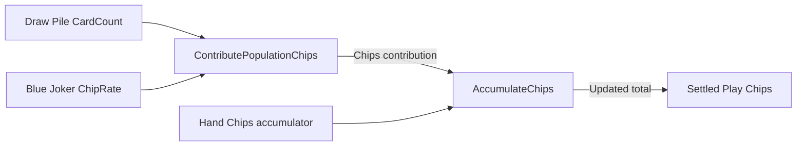
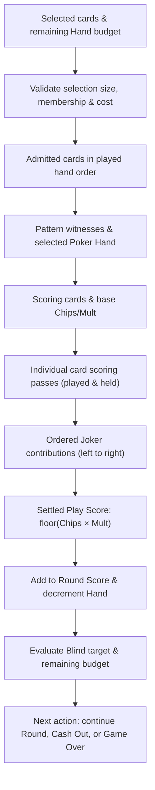

I've spent a fair amount of time asking what a game is, then what an architecture has to preserve to carry one. Those ideas are easier to hold while they sit above a diagram. Give 1 card an effect on another, and the diagram has a few more questions to answer.

This time I want to put those ideas to work on Balatro. I'll use Fantasia, a private experimental framework I built for my own tinkering. It is not a public engine, and I am not pitching it here (though I'm gonna say I quite like the name). What interests me is the path from the game I play to the relations I need to model.

LocalThunk created such a masterpiece, yet his code for it is quite messy. But, the game's the game, and Baltro is a great game, so I'll try to model it as I see it.

## Table of Contents

## Why Balatro?

A card supplies Chips, a Joker counts cards left in Draw, another changes Mult, and a seal grants an extra scoring pass out of nowhere. Each description is small, yet they quickly become a massive pile of garbage if left alone. In the original source, there are a million more `if`-`else` branches than anyone ever wanted to maintain.

The interesting part begins when these effects meet: a card grows between passes, a copied ability reads somebody else's current value, or moving a single Joker completely changes the score. I want to explain all those interactions with the same rules that explain individual cards. Adding a new card composed of existing meanings should only require declaring its values, and a new rule is owed only when the game introduces a truly new relation. The number of card names in the game should not dictate the structural complexity of the codebase.

This article works through that model using ordinary Balatro, then brings in a few Cryptid examples to test where expressive power breaks down. The C# code snippets are just concrete syntax from my prototype to show what these declarations look like in practice.

## Start with the things the game distinguishes

A Run owns cards, resources, progression, and history, while a Round supplies a score target and a budget of Hands and Discards. Playing consumes a Hand and evaluates whatever cards you selected, whereas discarding burns a different budget just to cycle that population. Hand size, selection limit, scoring membership, and remaining Hands all answer different questions.

Jokers, playing cards, and consumables all participate as cards, but their zones enforce completely different capacity and admission rules. A seal, edition, enhancement, or voucher can attach another layer of meaning to a card, and the scoring system needs to address that meaning directly instead of checking what concrete class the card belongs to.

Several identities need to stay separate:

| Identity or position | What it identifies in Balatro |
| --- | --- |
| Being | Authored static definition (e.g. rank, Joker definition, enhancement) |
| Subject | 1 living card instance on the table, in hand, or in the shop |
| Emitter | The card position originating an action or scoring pass |
| Provider | The card supplying the operative values or parameters |
| Recipient | The card or accumulator receiving the bonus |

2 cards created from the same definition remain 2 distinct Subjects. A Shop card exists as a Subject before the Run owns it. A card moving from Draw to Hand preserves its identity and ownership. In a Blueprint interaction, Blueprint is the emitter, while the Joker to its right is the parameter provider.

These distinctions matter before I choose any number. They determine which quantities can meet at all.

## Design truth and running truth

The first thing you have to separate is what a card is from what is happening to it right now. What a card is (its rank, baseline Chips, face card or not) never changes. Once you start playing, the card picks up live state: where it sits, what edition it got stamped with, and how many permanent bonuses it stacked up. If you mix these 2 up, you are in for a bad time: mutating card definitions in the middle of a run makes save states brittle, bleeds upgrades back into your base deck, and turns card effects into an untraceable mess of shared mutations.

Authored definitions are static claims. A rank definition looks like this:

```json
{
  "Rank_7": {
    "$Rank": {},
    "RankValues": {
      "Chips": 7,
      "Order": 5
    }
  }
}
```

Here `Rank` exposes `RankValues`, where the ordinal belongs to the authored rank relation rather than an entity index. Rank identity, ordinal value, face status, and intrinsic Chips are all distinct readings: J, Q, and K can each award 10 Chips without collapsing into the same rank.

What actually changes during a run is kept strictly in live state:

```csharp
public readonly record struct Ownership(Subject Owner);
public readonly record struct Location(Subject Area, BigInteger Ordinal);
public readonly record struct PermanentBonus(Chips Value);
```

These components represent live state, while card definitions describe static truth. Sharing a value shape does not make them interchangeable. When you level up Two Pair, the hand's baseline Chips in your progression component updates, but the authored definition of Two Pair remains untouched.

## A sentence, an equation, and an application

Take Blue Joker: it gives you Chips based on how many cards are left in your Draw pile. At its standard rate of 2 Chips per card, 23 cards in the deck give you 46 Chips. You can write that as a tiny pure equation:

```csharp
[Rule(typeof(TableWorld))]
public static class ContributePopulationChips
{
    public static void Apply(
        in ChipRate rate,
        in CardCount observed,
        out Chips contribution)
        => contribution = rate * observed;
}
```

The declaration states what varies together, and the expression supplies its arithmetic without querying entities, naming Blue Joker, or invoking subsequent rules.

For Blue Joker to score, the system needs an eligible source, its parameter provider, the Run's Draw count, and the Play's Chips accumulator. Their semantic relations determine which rate and count reach the multiplication. A signature alone cannot identify which of several card counts in the game is intended, but you do not need custom lookup glue once the domain establishes the relation: the meaning is declared once, and the compiler wires the dataflow.

If the Draw pile is empty, the observed count is a valid reading of zero, producing zero Chips. If the required population is missing entirely, the rule cannot be invoked. That distinction matters: doing nothing because an input is zero is very different from failing to run because a required piece is missing.

### A parameter reference is not its value

The ordinary rate for Blue Joker is 2 Chips per card, but when that rate scales, the live value belongs to that specific card instance rather than the static definition. 2 Blue Jokers on the table can easily hold different numbers.

A reference to the parameter identifies which variable is meant rather than a raw numeric operand, and the binding resolves that provider to feed `ChipRate` directly into the equation. If a position is ambiguous or missing, the compiler rejects it instead of quietly substituting zero.

`Chips`, `Mult`, `Factor`, `CardCount`, and `Money` carry different meanings and units. Their arithmetic follows those meanings: multiplying Chips-per-card by card count yields Chips. If you dump everything into a generic number bag, you throw away the exact type safety that keeps these combinations from breaking.

## How the rules meet without calling one another

Now look at how the score actually adds up. Another tiny function takes that Chips contribution and rolls it into the hand total:

```csharp
[Rule(typeof(TableWorld))]
public static class AccumulateChips
{
    public static void Apply(in Chips contribution, ref Chips total)
        => total = total + contribution;
}
```

The first function produces a value, and the second consumes that result into the hand total at the same scoring position. You do not need event dispatchers, pub/sub buses, or manual `RunAfter` annotations to hook them together: the dependency exists directly by construction.



The schedule is derived directly from this dataflow: because `AccumulateChips` consumes the result of `ContributePopulationChips`, the producer automatically precedes the consumer. No event dispatcher or manual priority sorting is needed.

The compiler also inspects method bodies reachable from the equations. A pure signature is worthless if a helper reads a service, captures mutable state, or invokes an arbitrary callback. Source code serves as evidence to analyze and lower, not a grab-bag of functions registered for the host to invoke at will.

## What determines order?

Suppose Mult starts at 4: adding 4 and then multiplying by 2 yields 16, whereas multiplying first and then adding gives 12. Both equations are well typed and share the same mutable accumulator, but arithmetic types alone cannot decide the direction.

In Balatro, card positions settle that choice naturally: an ordered scoring domain evaluates each Joker from left to right. Dragging an additive Joker past a multiplicative Joker alters the scoring sequence immediately, without requiring global priority tags between addition and multiplication classes.

The analyzer therefore reasons about more than method types:

| Existing evidence | What follows from it |
| --- | --- |
| 1 result supplies another input | The producer precedes that consumer |
| An ordered application domain | Replacements follow the left-to-right Joker or card order |
| A reduction over a complete population | Scoring accumulates all cards in the played hand |
| Stage order | Hand scoring settlement precedes end-of-round interest and cash-out |
| Disjoint mutable state | Modifying separate cards or resources can proceed independently |

Reading a card's static definition creates no mutable conflict. Modifying independent cards or separate resource pools can happen in parallel.

Only a meaningful relation left unresolved by this evidence needs explicit before/after. If A precedes B and B supplies C, A already precedes C. Repeating that fact adds authoring burden without adding game meaning.

If 2 possible orders produce different outcomes and the model chooses neither, compilation must diagnose the ambiguity. File order, registration order, backend enumeration, and alphabetical names cannot decide it. Once a valid partial order exists, independent work can form parallel waves. Parallelism follows from the analysis.

Several contributions converging on 1 target also need a valid combination. An ordered fold preserves source order. A regroupable reduction needs the relevant identity and algebraic properties under its numeric contract. An explicitly collected result can instead become another rule's input. Last-write-wins supplies none of these meanings.

A temporal stage expresses when steps occur, while the game state holds current truth. Scoring hands, calculating interest, and generating shop inventory happen across distinct stages without needing duplicate entities or exposing the scheduler to game rules.

### Which version does a reader receive?

Your Money can change multiple times while a single hand is scoring. Say you start the hand with $4: To Do List triggers mid-score and hands you another $4, and Bull triggers later on. Bull evaluates against the fresh $8 balance at its slot, whereas Vagabond and the interest cap hold onto the original $4 snapshot taken when the hand started. The payout happens once, and reading it later does not pay it again.

The relation must distinguish an entry capture from an ordered prefix reading. Where that boundary already follows from the declared domain, the analyzer derives it. Where the game genuinely chooses between old and new values, that choice is authored once, and the compiler generates the capture and its lifetime.

A blanket snapshot misses later updates, while a universal latest-value policy erases earlier readings. Neither can substitute for the game's actual relations.

## Growth makes the read boundary visible

Hologram starts with a 1x multiplier and gains +0.25 every time a playing card actually gets added to your deck:

```csharp
[Rule(typeof(TableWorld))]
public static class GrowScoringFactor
{
    public static void Apply(
        in GrowthRate rate,
        in CardCount qualifying,
        ref Factor factor)
        => factor = factor + rate * qualifying;
}
```

The qualifying count comes from the exact acquisition or creation event. Buying a Shop card counts even though the card already existed in the World, whereas drawing an already-owned card does not. Initial composition and save restore never manufacture spurious acquisition events.

A later scoring application reads the retained factor. The result of growth becomes that later input through a real live position, without a notification bus or a second copy of the factor.

Hiker modifies the recipient card directly, adding 5 permanent Chips after the current pass has already read the card's baseline contribution. If a 7 of Spades with zero bonus scores twice in 1 hand (via a Red Seal), the 2 passes unfold sequentially:

```text
pass 0: intrinsic 7,  permanent bonus becomes 5
pass 1: intrinsic 12, permanent bonus becomes 10
```

The ordering belongs strictly within each pass: forcing all intrinsic reads to precede all growth writes across the entire hand would yield 2 reads of 7, breaking the game. Once the pass relation specifies the exact read-and-replace lifecycle, the compiler interleaves them across the evaluation domain.

Internally this can be understood as `bonus₀ → bonus₁ → bonus₂`. The compiler can distinguish those value versions without requiring hand-written before/after components. A `ref` read followed by a replacement is not a dependency cycle merely because the component type appears on both sides.

Blueprint introduces an indirection: it occupies its own scoring position as an emitter, but forwards execution to the provider on its right to supply the actual rule and parameters. Forwarding does not clone state onto Blueprint or alter the target Joker: eligibility, delegation routes, and mutation authority remain separate concerns.

## Recognition produces witnesses, not just a hand name

When you throw down up to 5 cards and hit Play, hand recognition gives you 3 separate facts rather than a single string:

1. Which poker patterns are present in the cards, and which specific cards witness them.
2. Which pattern is selected as the primary hand to set base Chips and Mult.
3. Which subset of cards actually get to score.

A **witness** is the physical evidence for a pattern. If you play a Full House, you also have a Pair sitting in there. A Joker asking whether a Pair is present and the Observatory voucher asking which poker hand just scored are asking 2 totally different questions.

Several witnesses require an explicit preference policy. A compound pattern needs a relation combining its constituent witnesses. An implication between pattern names alone does not specify which members become the implied witness. Royal Flush can be a qualifying Straight Flush reading without another progression coordinate.

Four Fingers drops Straights and Flushes down to 4 cards, Shortcut lets you skip ranks in Straights, Splash forces all 5 cards to score even if they are not part of the hand, and Stone cards score Chips without having a rank or suit. None of these need custom `if (has_joker('Splash'))` branches inside your poker hand recognizer. You just model what cards witness what, and what cards are admitted to score.

For an ordinary level-1 Pair played as `7♥, 7♠, K♣`, the sevens witness the selected Pattern:

```text
Chips = 10 + 7 + 7 = 24
Mult  = 2
Score = floor(24 × 2) = 48
```

3 cards were played, 2 normally score, and 1 Hand was spent. Repeating a 7's scoring pass changes none of those 3 counts. History readers need the correct occurrence, not an undifferentiated trigger count.

## Repetition is a finite application domain

Here is 1 of the most famous combos in the game: Baron, Mime, and a Red-sealed Steel King held in hand.

Steel gives a 1.5x multiplier. Baron gives another 1.5x multiplier for every King held in hand. Red Seal gives that held card another scoring pass, and Mime gives another pass because the card has held-in-hand abilities.

```text
passes           = 1 base + 1 Red Seal + 1 Mime = 3
factors per pass = 1 Steel + 1 Baron = 2
combined factor  = 1.5⁶ = 11.390625
```

1 card supplies 3 passes and 6 contributions. Mime adds an extra pass to the evaluation list instead of doubling an already-expanded count. If you have 2 Mimes, the second one just adds another pass to the queue without blowing up in a recursive loop.

A repeat allowance needs its own quantity and scope. It is not a consumable-use quota. The game rules declare which result justifies an allowance, when it is read, and which finite applications it adds. The engine iterates those applications, carries updated values forward, and routes each result.

The power expression summarizes this example because all 6 factors stay fixed. A pass that changes a later factor prevents that compression unless an equivalent relation is established. Floating-point regrouping also needs the chosen numeric contract, because mathematical associativity does not grant arbitrary machine reassociation.

Terminal-Round repetitions have another application domain. A held-scoring allowance does not automatically authorize repeating terminal effects. The shared idea is finite reapplication, with the game's distinct populations and conditions preserved.

A process returning to Round after a Play is also different from an instantaneous execution cycle. It begins another transition from a settled state. A genuine cyclic dependency within 1 resolution needs declared iteration or fixed-point meaning, with termination or convergence evidence. The scheduler cannot invent that meaning by repeatedly calling factors until they happen to stop changing values.

## Game flow: Readings, transitions, and decisions

Balatro is more than card scoring: it is a discrete state machine driven by readings:

1. **After a play scores**: Did the total score reach the Blind target? If yes, transition to Round Settlement and the Shop. If not, are there remaining Hands? If yes, return to the play/discard loop, and if not, the Run is lost.
2. **In the Shop**: The player can purchase cards, open packs, reroll stock, or leave. Buying items or rerolling modifies state within the shop, but leaving advances the run to the next Blind choice.
3. **Blind progression**: Small, Big, and Boss Blinds present specific targets and schedule meaning. Skipping a Blind grants a tag reward and advances the Ante without scoring a round.

These readings and transitions sit in the same dataflow as card scoring. The system does not enter a chaotic callback that pays Money, rolls shop stock, and mutates arbitrary components all at once. State transitions are declared relations: what was reached, what budget remains, and which continuation is valid.

## 1 Play, from card selection to continuation

When a player selects cards and hits Play, the game evaluates that proposal through an explicit resolution chain:



This diagram maps the formal dependencies rather than a sequence of manual callbacks. Independent admission checks can run together, while specific effects introduce further result dependencies or capture relations. The analyzer derives the execution schedule from the complete form.

The score equation itself remains small:

```csharp
[Rule(typeof(TableWorld))]
public static class HandScore
{
    public static void Apply(in Chips chips, in Mult mult, out Score score)
        => score = new(Math.Floor(chips.Value * mult.Value));
}
```

Its operands are the settled scoring quantities for that Play. The result contributes to the bound Round's Score. The resulting Round Score supplies the target test. Those producer/consumer edges need no additional before/after annotations.

A refused proposal commits no partial consequences. An admitted Play that loses the Run still spends its budget and produces its defined results. Refusal and an unfavorable outcome are different. Replacements evaluated while establishing a candidate are not permission to mutate the committed state early.

Ports outside the active output scopes retain their values. Several active rules must agree on the admitted target rather than commit competing writes in whichever order the backend happens to visit them. When a relation deliberately permits several targets, a later declared choice may select among them, and the compiler cannot silently substitute its first candidate.

The next action starts from settled game state. Host framerate does not define a Play, scoring pass, or Shop visit. The player sees the presented game view, not internal engine buffers.

## Properties, permissions, and actual outcomes

A card can wear a lot of hats: enhancements, editions, seals, and stickers. If a Boss Blind disables a Joker, it loses its ability, but a Negative edition still gives you +1 Joker slot because you still own the card.

Face-down cards hide their visual values, but their underlying rank and suit still exist. Selling or disabling a Blind does not refund money or cards already lost. A reversal needs an authored relation and the values that justify it. Losing capacity can leave an area over its limit, but admitting the next receipt remains a separate question.

Population changes distinguish retained, entering, and ending participation. Moving a card retains its Subject. Receiving it changes possession. A fresh clone receives a new Subject, whereas copying specified properties onto an existing card preserves the target's identity. Regeneration applies its declared defaults, while restore retains captured current truth.

These are target state relations. The rules govern domain relations, leaving entity allocation, relocation, and deletion to the underlying storage.

Actual outcomes can be inputs to further rules. Hologram reads actual ownership entry. Shatter-based growth can read actual shatter, retaining the qualifying cause and occurrence. 2 proposals to remove 1 card do not establish 2 actual terminations. Source reward multiplicity can still differ from victim multiplicity: 2 eligible Trading Cards can each contribute income while their shared discarded victim ends once.

For shatter, this model deliberately normalizes observation to the actual qualifying outcome. Some native Lua paths notify observers before setting the shatter marker and compensate in consumable-specific paths. Preserving those implementation accidents would require their observable distinctions to be modeled explicitly, and the outcome relation used here does not claim equivalence to every such path.

A local outcome functions as an intermediate value whose lineage and lifetime are managed by the compiler, avoiding temporary event entities. A remembered history value needs a live position only when a later continuation can inspect it.

## Purchases, uses, and Pack choices

A purchase relates a quoted price, payment authority, balance, credit floor, receipt, placement, and capacity. Its candidate must satisfy them together. Payment and receipt must commit together, preventing orphaned deductions if placement fails.

A coupon can waive payment while retaining the priced basis used for sale. A zero paid-price basis does not grant an unlimited free-reroll allowance. A valid reorder can leave the order unchanged and still count as an operation. Numeric delta and operation presence are different results.

Consumable use identifies its source and complete target selection. An untargeted use has an explicitly empty target domain. A failed chance outcome can remain an accepted use without restoring the consumed source. Sigil chooses a shared suit for the Hand, so the resulting value feeds several replacements without drawing again for each card.

A Pack owns options, a choice quota, and its exact parent Return position. An admitted choice with that Pack origin spends the quota. Using an inventory consumable while the Pack is open does not acquire the same origin. Skip and quota exhaustion can both close a Pack while remaining distinct outcomes.

Offer generation needs complete eligibility, availability, bans, duplicate policy, weights, and entropy. A previous selection can affect the next population. A draw's continuation is explicit running truth. Reading a draw result does not consume another draw, and equal distributions do not guarantee equal seeded continuations.

### Perkeo, Observatory, and capacity rights

Perkeo creates a Negative copy of a possessed consumable when leaving the Shop. Observatory lets each eligible possessed Planet supply a factor of 1.5 when its hand mapping matches the selected Pattern. The Planet stays in inventory and performs no ordinary level-up use.

For `n` eligible matching instances, the combined factor is `1.5ⁿ`. A Full House containing a Pair does not qualify a Pair-mapped Planet for Observatory. Deduplicating equal definitions would discard the distinct copies Perkeo produced.

The redeemed standing permission belongs to the Run rather than individual consumables. Its intersection with possession and the hand mapping activates the contribution directly.

A fresh Negative copy supplies both an incoming member and a capacity right in the same receipt candidate: 2 occupied consumable slots with basis 2 can become 3 occupied slots with effective limit 3. If the card leaves possession, its supported right ends. Antimatter instead raises the Joker-capacity basis on redemption. Equal displayed limits can therefore have different future behavior.

Copy applications also need the right reading boundary. An earlier copy may affect a later choice. It does not automatically join a source roster already captured for another relation. Selection, copying, edition replacement, receipt, capacity, and participation compose cleanly without ad-hoc cross-card handlers.

### Retcon changes 1 condition

Director's Cut permits a paid Boss replacement once per Ante under the corresponding schedule allowance. Retcon waives the frequency restriction. The ordinary $10 payment, active-offer identity, and replacement eligibility retain their meanings.

The constraints can be stated separately:

```text
payment:       balance_after = balance_before − quoted_cost
credit:        the resulting balance respects the applicable floor
permission:    this active Boss offer can be replaced
frequency:     unused allowance OR a policy waiving that restriction
replacement:   a choice from the complete eligible Boss population
```

Retcon waives the frequency limit while leaving payment and eligibility checks intact. Renewing the scope resets ordinary frequency memory, whereas merely decreasing Ante does not. Replacing an offer establishes a new schedule member even if the selected Blind definition happens to be equal. A stale Contribution naming the old member remains stale.

## Settlement, Profile, and restore

Terminal-Round consequences have their own populations and order. Survival, held-card effects, exhaustion, and rental obligations do not all follow from 1 win flag. An obligation already bound to an application does not disappear merely because its own source ends during resolution.

Settlement is separate from owned Money. Under the ordinary policy, unused Hands contribute $1 each and interest contributes $1 per complete $5 held, up to $5. If direct terminal income changes Money from $4 to $7 and an unclaimed settlement contains another $2, the relevant principal is $7. Claiming transfers the settlement and establishes its once-only claimed fact together.

The Profile tracks persistent progress: unlocked Jokers, discovered consumables, and win records. At the end of a round or upon discovering a new card, settled values transfer to the Profile without leaking the active run's mutable entities.

A save retains only operative truth: card identities, order, current parameters, history, pending permissions, Pack quota, unclaimed settlement, and RNG state. Restore starts directly from that state, without replaying initial grants, acquisition growth, or accepted uses. A factor-local scoring accumulator needs no persistent component when nothing outside that atomic resolution can inspect it.

## Cryptid tests different limits

If you want to see where traditional game code really breaks, look at Cryptid. The mod pushes card interactions so far that hardcoded logic falls apart completely:

### Exponentia reads the occurrence of an operation

Exponentia starts with exponent 1. Its ordinary growth adds 0.03 after a handled XMult application whose factor differs from 1. At its main scoring position, it raises Mult to its current exponent.[^exponentia]

2 separate `x2` applications and 1 `x4` application can produce the same Mult while causing different growth. Their occurrences remain operative evidence:

```text
qualifying scale occurrence → exponent_after = exponent_before + 0.03
power application           → Mult_after = Mult_before ^ current_exponent
```

The growth rule consumes the exact operation result, including the handled operand and origin. The analyzer derives that result edge. A trigger announcement or final Mult delta cannot substitute for it. Growth before Exponentia's position affects its exponent there, but subsequent growth cannot alter an earlier result. Its power operation remains distinct from XMult even though both modify Mult.

### Light needs a finite threshold relation

Light accumulates progress from the other scoring cards in a qualifying application. Its defaults are requirement 5, remaining progress 5, and factor 1. Each crossing adds 0.2 to the factor and raises the next requirement by 5, carrying any excess progress forward.[^light]

Let `a`, `q`, and `d` be this application's entry remaining progress, requirement, and incoming count. Choose the least nonnegative integer `k` satisfying:

```text
a_after = a − d + kq + 5k(k + 1)/2 > 0
q_after = q + 5k
f_after = f + 0.2k
```

With 17 scoring cards there are 16 others. Starting from the defaults gives 2 crossings: `a_after = 14`, `q_after = 15`, and `f_after = 1.4`.

The positive-step relation supplies a finite least solution. Its crossing count is 1 result feeding 3 1-writer replacement equations. The compiler derives those dependencies and their candidate composition. The game specifies the mathematical relation, avoiding custom loop logic tied to an individual card.

### Old Membership Card needs Measurement

Old Membership Card bases Chips on the Cryptid Discord member count. Its ordinary reading uses 1 Chip per member, whereas the balanced variant groups members by 8.[^old-membership-card]

That value is neither deck population nor immutable Knowledge. An explicit Measurement contract supplies a complete value at a declared capture boundary. A durable capture becomes a represented port, whereas a reading used only within a single resolution can remain factor-local. Replay must retain or reproduce the actual supplied value under that contract.

The scoring equation receives the typed count directly, leaving network requests to the measurement apparatus. The capture establishes the causal input, while the apparatus realizes how it is measured. Discord members and playing cards remain different counted units.

### Googol Play Card tests numeric realization

Googol Play Card ordinarily offers a 1-in-8 chance of multiplying Mult by `10¹⁰⁰`.[^googol-play-card] Trial and multiplication remain familiar relations.

But `10²⁵⁰ × 10¹⁰⁰ = 10³⁵⁰` exceeds binary64's finite range. If later rules distinguish such values, collapsing them to infinity changes the game. Range, rounding, and exponentiation need a concrete numeric realization preserving the semantic quantity. A larger magnitude need not create a new rule, and calling everything Number does not solve representation.

## Why model it this way?

Balatro's original Lua source is famous for being a messy pile of nested `if`-`else` checks, global tables, and ad-hoc flags. It worked because LocalThunk is a genius who held the entire game in his head, and the heart of the game, the game design of Balatro is wonderful. But, anyone who has ever tried writing a complex mod for it knows how fragile that gets. You add 1 card, and suddenly 3 other cards stop triggering in the right order.

When you flip the architecture around, you do not write cards as imperative scripts that poke each other. You declare what cards are, what live components they carry, and write pure mathematical equations for their interactions.

```csharp
using var runtime = BalatroGame.CreateRuntime(new ArchBinding());
using var session = runtime.Start(BalatroGame.CreateInitial(seed: seed));
using var host = MonoGameHost.Create(runtime, options);
using var operatorBinding = host.Bind(
    session.Roles.RunOperator,
    RoleInspector.MouseAndKeyboard());

host.Run();
```

It contains no direct game rule calls. The host advances configured boundaries, while generated execution realizes their dataflow applications.

A new card that uses existing mechanics requires only new data: its claims and baseline values. A genuinely new mechanic requires defining the new relation and its equations once. In neither case do you crack open a monolithic scoring switch-statement or invent another ad-hoc trigger stage.

Fantasia is just my private, unreleased sandbox for testing these architectural ideas. I am not pitching a framework here. But Balatro demonstrates why game architecture needs better foundations: when mechanics compound, the only way to keep a game manageable is to let mathematics and relations define the rules, and let the compiler worry about execution order.

[^exponentia]: Cryptid, Exponentia definition and scaling hook, [`items/exotic.lua`](https://github.com/SpectralPack/Cryptid/tree/main/items/exotic.lua).
[^light]: Cryptid, Light enhancement definition, [`items/misc.lua`](https://github.com/SpectralPack/Cryptid/tree/main/items/misc.lua).
[^old-membership-card]: Cryptid, Old Membership Card descriptions, [`localization/en-us.lua`](https://github.com/SpectralPack/Cryptid/tree/main/localization/en-us.lua).
[^googol-play-card]: Cryptid, Googol Play Card definition, [`items/epic.lua`](https://github.com/SpectralPack/Cryptid/tree/main/items/epic.lua).
