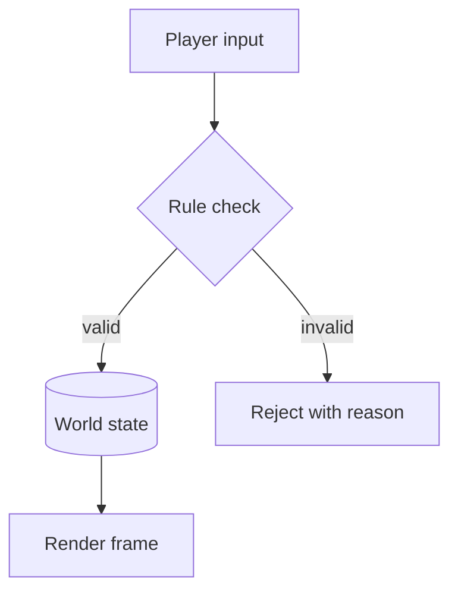
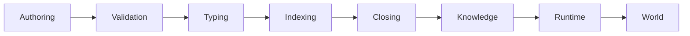
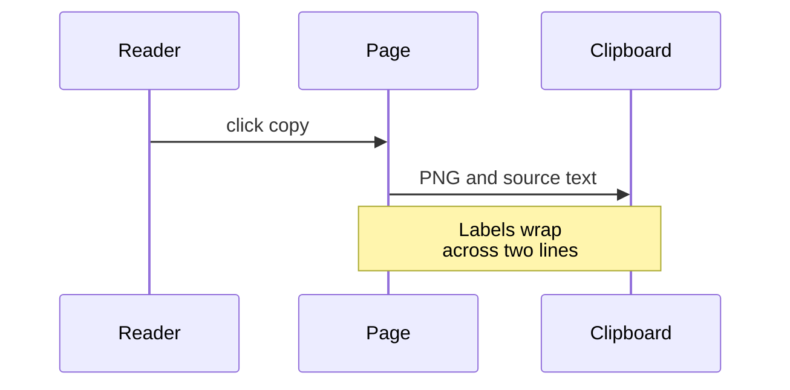
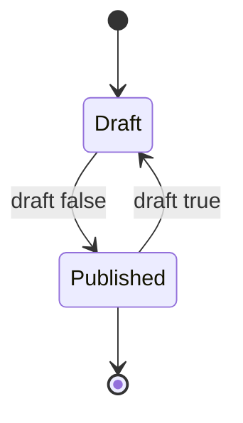
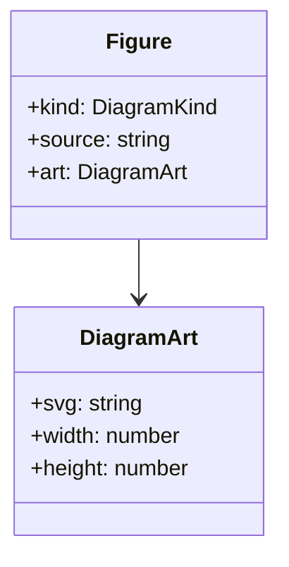
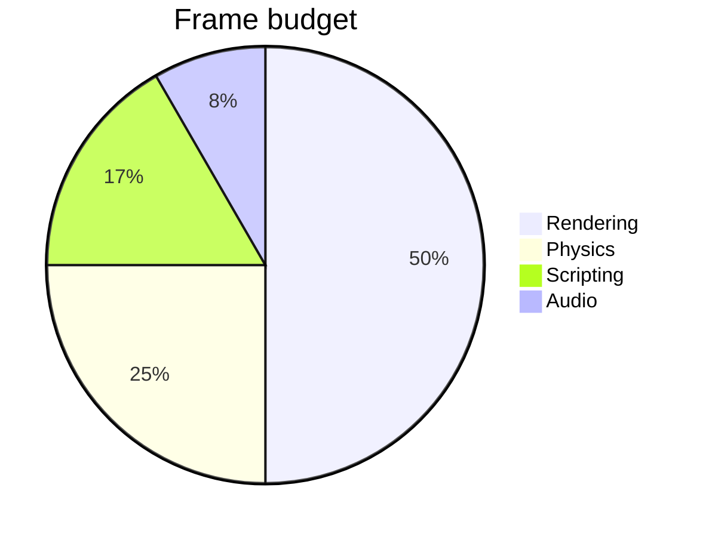

<!--
  Test page, never published (draft: true, visible only in `bun run dev`).
  It is still compiled by `bun run build`, so a broken diagram or chart here fails the build.
  Add a section whenever the content pipeline learns a new feature, and mirror it in
  render-fixtures.vi.md with the same heading levels (bilingual TOC check).
-->

This page exercises every block the Markdown pipeline turns into components. Open it next to the
Vietnamese version to compare locale-specific output.

## Table of contents

## Does inline text render?

Plain paragraph with **bold**, *italic*, ***both***, ~~strikethrough~~ and `inline code`. An
[internal link](/articles), an [external link](https://svelte.dev) and a footnote reference[^note].
A raw <mark>highlighted phrase</mark> uses the static mark style.

A paragraph with a hard line break  
continues on the next line.

### Does a long unbroken string wrap?

Supercalifragilisticexpialidocious_and_a_very_long_identifier_name_without_spaces_to_check_overflow.

## Do lists render?

### Unordered and nested

- First item
- Second item with a nested list
  - Nested item
  - Another nested item
    - Third level
- Last item

### Ordered

1. Step one
2. Step two
3. Step three

### Tasks

- [x] Done task
- [ ] Open task

## Does a quote render?

> A quote paints the pencil-edge border. It should wobble only while it is on screen.
>
> A second paragraph inside the same quote.

## Does code render?

### Highlighted languages

```typescript
type Language = 'en' | 'vi';

export function greet(name: string, lang: Language): string {
	return lang === 'vi' ? `Xin chao, ${name}` : `Hello, ${name}`;
}
```

```svelte
<script lang="ts">
	let { count = 0 }: { count?: number } = $props();
</script>

<button onclick={() => count++}>{count}</button>
```

```bash
bun run check && bun run build
```

```json
{ "draft": true, "tags": ["fixtures"] }
```

### Diff

```diff
- const label = 'Chart';
+ const label = spec.description ?? t.a11y.diagram;
```

### Plain block

```
No language: rendered as plain text with the notebook rulings.
```

## Do tables render?

### Field list

| Feature | Owner | Notes |
| --- | --- | --- |
| Figure | content layout | Prerendered SVG with pan and zoom |
| Code block | content layout | Shiki output with a pinned copy button |
| Card stack | rehype plugin | Mobile view built from the same table |

### Comparison

| Capability | Engine A | Engine B | Engine C |
| --- | --- | --- | --- |
| Hot reload | yes | no | yes |
| ECS | yes | yes | no |
| Scripting | no | yes | yes |

### Checkbox cells

| Task | Desktop | Mobile |
| --- | --- | --- |
| **Render** | [x] | [x] |
| Animate | [/] | [ ] |
| Export | [x] | [/] |

### Two columns

| Term | Meaning |
| --- | --- |
| Rule | A constraint the game enforces |
| State | Everything a rule can read |

### Wide table

| Column 1 | Column 2 | Column 3 | Column 4 | Column 5 | Column 6 | Column 7 |
| --- | --- | --- | --- | --- | --- | --- |
| a long cell value | another long value | third value | fourth value | fifth value | sixth value | seventh value |

## Do diagrams render?

### Flowchart top-down



### Wide flowchart



### Sequence



### State



### Class



### Pie



### Bar chart

```vega-lite
{
  "description": "Frame budget by system",
  "width": 420,
  "data": {
    "values": [
      { "system": "Rendering", "ms": 6.2, "kind": "GPU" },
      { "system": "Physics", "ms": 3.1, "kind": "CPU" },
      { "system": "Scripting", "ms": 2.4, "kind": "CPU" },
      { "system": "Audio", "ms": 0.8, "kind": "CPU" }
    ]
  },
  "mark": "bar",
  "encoding": {
    "y": { "field": "system", "type": "nominal", "sort": "-x", "title": null },
    "x": { "field": "ms", "type": "quantitative", "title": "Milliseconds per frame" },
    "color": { "field": "kind", "type": "nominal" }
  }
}
```

### Line chart

```vega-lite
{
  "description": "Frame time over a session",
  "width": 420,
  "data": {
    "values": [
      { "minute": 1, "ms": 14 },
      { "minute": 2, "ms": 15 },
      { "minute": 3, "ms": 13 },
      { "minute": 4, "ms": 18 },
      { "minute": 5, "ms": 16 }
    ]
  },
  "mark": { "type": "line", "point": true },
  "encoding": {
    "x": { "field": "minute", "type": "quantitative", "title": "Minute" },
    "y": { "field": "ms", "type": "quantitative", "title": "Frame time (ms)" }
  }
}
```

## Does math render?

Inline math sits in the sentence: $e^{i\pi} + 1 = 0$.

$$
\sum_{k=1}^{n} k = \frac{n(n+1)}{2}
$$

## Does an image open the lightbox?


## Does a disclosure render?

<details>
<summary>Click to expand</summary>

Hidden content inside a native disclosure, with **Markdown** still parsed.

</details>

<!--
  Known gap: GFM footnotes are not parsed (mdsvex 0.12 bundles a pre-micromark
  remark-parse that remark-gfm 4 cannot extend), so `[^note]` renders literally.
-->

[^note]: Footnote text, linked back to its reference.
