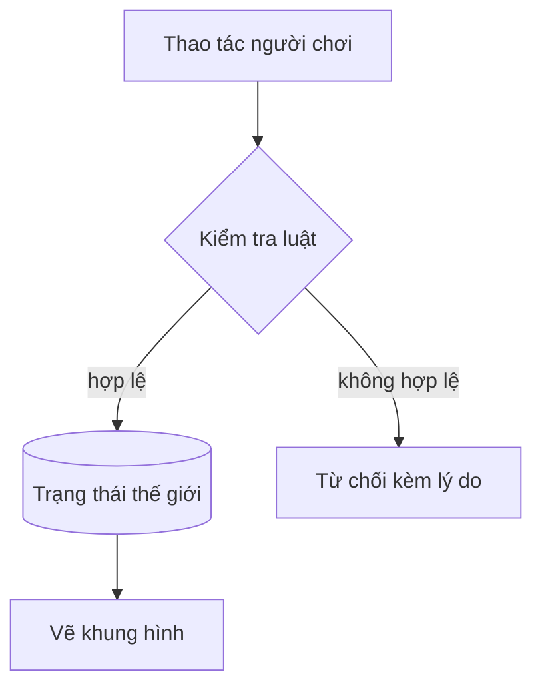
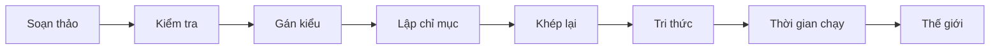
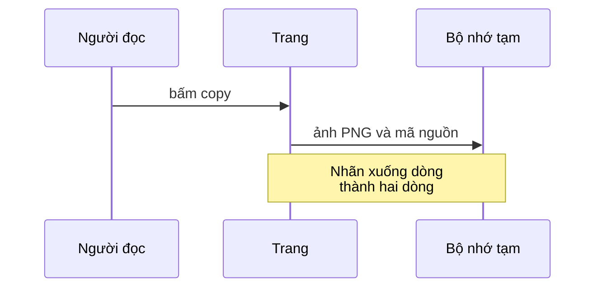
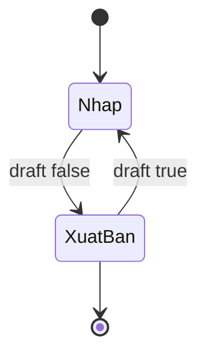
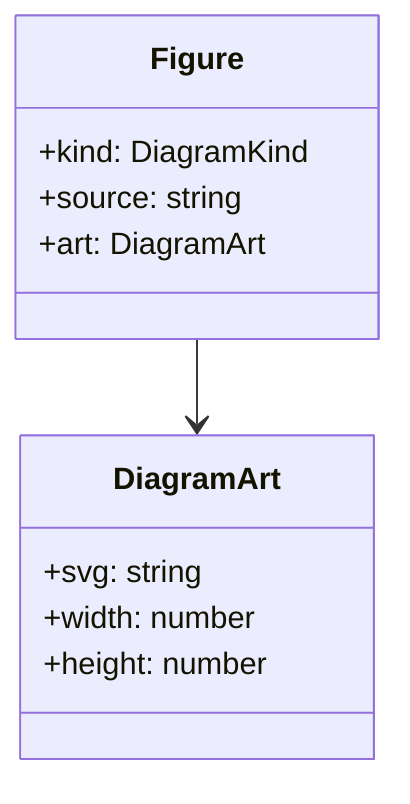
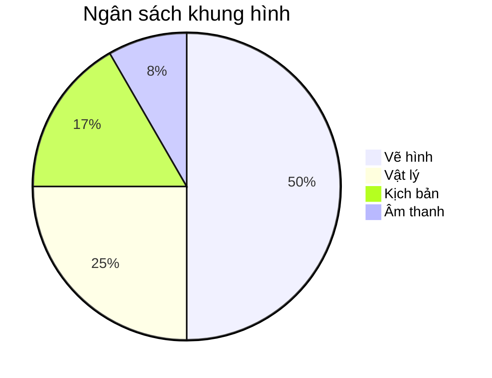

<!--
  Bản tiếng Việt của render-fixtures.md: giữ đúng thứ tự và cấp heading (kiểm tra TOC song ngữ).
  Dùng để xem chuỗi i18n, mục lục "Mục lục", ngày tháng và chữ có dấu trong diagram.
-->

Trang này chạy qua mọi khối mà pipeline Markdown biến thành component. Mở cạnh bản tiếng Anh để so
sánh phần hiển thị theo ngôn ngữ.

## Mục lục

## Chữ và định dạng inline có hiển thị đúng không?

Đoạn văn thường có **chữ đậm**, *chữ nghiêng*, ***cả hai***, ~~gạch ngang~~ và `code inline`. Một
[link nội bộ](/vi/articles), một [link ngoài](https://svelte.dev) và một chú thích[^note]. Một
<mark>cụm từ được tô</mark> viết bằng HTML thô dùng kiểu mark tĩnh.

Một đoạn có ngắt dòng cứng  
tiếp tục ở dòng sau.[^second]

### Chuỗi dài không có khoảng trắng có xuống dòng không?

Mộtchuỗirấtdàikhôngcókhoảngtrắngđểkiểmtrachuyệntrànkhungkhihiểnthịtrênmànhìnhhẹp_và_tên_biến_dài.

## Danh sách có hiển thị đúng không?

### Không đánh số và lồng nhau

- Mục đầu tiên
- Mục thứ hai có danh sách con
  - Mục con
  - Mục con khác
    - Cấp thứ ba
- Mục cuối

### Đánh số

1. Bước một
2. Bước hai
3. Bước ba

### Việc cần làm

- [x] Việc đã xong
- [ ] Việc chưa xong

## Trích dẫn có hiển thị đúng không?

> Trích dẫn có viền nét chì. Nét chì chỉ rung khi trích dẫn đang trên màn hình.
>
> Đoạn thứ hai trong cùng trích dẫn.

## Code có hiển thị đúng không?

### Các ngôn ngữ được tô màu

```typescript
type Language = 'en' | 'vi';

export function greet(name: string, lang: Language): string {
	return lang === 'vi' ? `Xin chao, ${name}` : `Hello, ${name}`;
}
```

```svelte
<script lang="ts">
	let { count = 0 }: { count?: number } = $props();
</script>

<button onclick={() => count++}>{count}</button>
```

```bash
bun run check && bun run build
```

```json
{ "draft": true, "tags": ["fixtures"] }
```

### Diff

```diff
- const label = 'Chart';
+ const label = spec.description ?? t.a11y.diagram;
```

### Khối không có ngôn ngữ

```
Không có ngôn ngữ: hiển thị như văn bản thường với kẻ dòng kiểu vở.
```

## Bảng có hiển thị đúng không?

### Danh sách trường

| Tính năng | Nơi quản lý | Ghi chú |
| --- | --- | --- |
| Figure | layout nội dung | SVG dựng sẵn, có kéo và phóng to |
| Khối code | layout nội dung | Kết quả Shiki với nút copy ghim góc |
| Thẻ bảng | plugin rehype | Dạng mobile dựng từ chính bảng này |

### So sánh

| Khả năng | Engine A | Engine B | Engine C |
| --- | --- | --- | --- |
| Hot reload | có | không | có |
| ECS | có | có | không |
| Scripting | không | có | có |

### Ô checkbox

| Việc | Desktop | Mobile |
| --- | --- | --- |
| **Hiển thị** | [x] | [x] |
| Chuyển động | [/] | [ ] |
| Xuất ảnh | [x] | [/] |

### Hai cột

| Thuật ngữ | Ý nghĩa |
| --- | --- |
| Luật | Ràng buộc mà game áp đặt |
| Trạng thái | Mọi thứ một luật có thể đọc |

### Bảng rộng

| Cột 1 | Cột 2 | Cột 3 | Cột 4 | Cột 5 | Cột 6 | Cột 7 |
| --- | --- | --- | --- | --- | --- | --- |
| giá trị ô khá dài | một giá trị dài khác | giá trị ba | giá trị bốn | giá trị năm | giá trị sáu | giá trị bảy |

## Diagram có hiển thị đúng không?

### Flowchart từ trên xuống



### Flowchart rộng



### Sequence



### State



### Class



### Pie



### Biểu đồ cột

```vega-lite
{
  "description": "Ngân sách khung hình theo hệ thống",
  "width": 420,
  "data": {
    "values": [
      { "system": "Vẽ hình", "ms": 6.2, "kind": "GPU" },
      { "system": "Vật lý", "ms": 3.1, "kind": "CPU" },
      { "system": "Kịch bản", "ms": 2.4, "kind": "CPU" },
      { "system": "Âm thanh", "ms": 0.8, "kind": "CPU" }
    ]
  },
  "mark": "bar",
  "encoding": {
    "y": { "field": "system", "type": "nominal", "sort": "-x", "title": null },
    "x": { "field": "ms", "type": "quantitative", "title": "Mili giây mỗi khung hình" },
    "color": { "field": "kind", "type": "nominal" }
  }
}
```

### Biểu đồ đường

```vega-lite
{
  "description": "Thời gian khung hình trong một phiên chơi",
  "width": 420,
  "data": {
    "values": [
      { "minute": 1, "ms": 14 },
      { "minute": 2, "ms": 15 },
      { "minute": 3, "ms": 13 },
      { "minute": 4, "ms": 18 },
      { "minute": 5, "ms": 16 }
    ]
  },
  "mark": { "type": "line", "point": true },
  "encoding": {
    "x": { "field": "minute", "type": "quantitative", "title": "Phút" },
    "y": { "field": "ms", "type": "quantitative", "title": "Thời gian khung hình (ms)" }
  }
}
```

## Công thức toán có hiển thị đúng không?

Công thức inline nằm trong câu: $e^{i\pi} + 1 = 0$.

$$
\sum_{k=1}^{n} k = \frac{n(n+1)}{2}
$$

## Ảnh có mở lightbox không?


## Khối mở/đóng có hiển thị đúng không?

<details>
<summary>Bấm để mở</summary>

Nội dung ẩn trong khối mở/đóng gốc của trình duyệt, **Markdown** bên trong vẫn được xử lý.

</details>

[^note]: Nội dung chú thích, có link quay về chỗ tham chiếu.
[^second]: Chú thích thứ hai, đánh số theo thứ tự được nhắc tới lần đầu.
